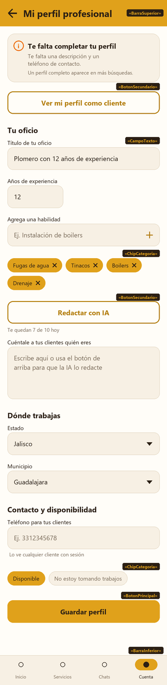
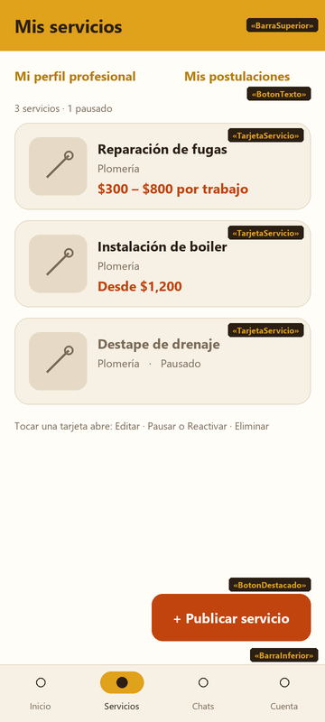
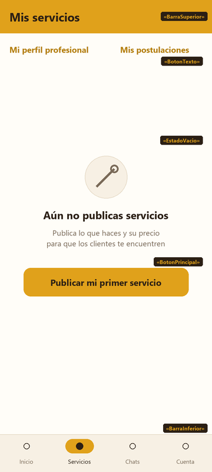
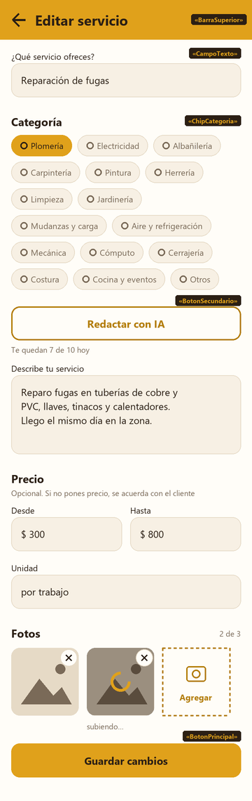

# Diseño de las pantallas del trabajador · P-11, P-12 y P-13

> Entregable de **`S3-T01`**. Es el documento que consumen `S3-T03` (P-11),
> `S3-T04` (P-13), `S3-T05` (P-12), `S3-T06` (ViewModels), `S3-T07`
> (validaciones) y `S3-T13` (botón de IA). Lo que aquí no esté, no se
> implementa; lo que aquí esté, se implementa tal cual.

**Fecha:** 2026-10-18 · **Responsable:** LMM ·
**Rama:** `docs/S3-T01-diseno-perfil-servicios`

---

## 0. Alcance de esta tarea

El ticket es `docs/tareas/S3-T01.md`. Tiene la misma forma que
[`DISENO-AUTENTICACION.md`](DISENO-AUTENTICACION.md), con una diferencia:
P-11, P-12 y P-13 **no tenían wireframe**, así que aquí también se dibujan.

### Qué entra

1. El wireframe de P-11, P-12 (con datos y vacía) y P-13, en
   [`wireframes/`](wireframes/) y en [`WIREFRAMES.md`](WIREFRAMES.md).
2. La anatomía de cada pantalla con medidas, de arriba hacia abajo.
3. El contrato de estado y de eventos de cada pantalla.
4. Qué estados de pantalla existen y cuáles no aplican, con el porqué.
5. Las reglas de validación campo por campo, con texto y clave.
6. El mapa de `TipoError` a lo que ve el usuario en cada operación.
7. Las claves de `strings.xml` que hay que crear.
8. Dónde va el botón "Redactar con IA" y cómo se ve en cada uno de sus
   estados. **Solo el diseño**: cómo se conecta es de `S3-T13` y `S4-T10`.

### Qué NO entra

- **Código.** Ni Kotlin ni `strings.xml`. Las cadenas se listan aquí con su
  clave, pero las agrega la tarea que construye cada pantalla.
- **P-07 Perfil público.** Lo diseña `S4-T01` y lo construye `S4-T03`. Aquí
  solo se dice cómo se llega a la vista previa (HU-08).
- **El estado vacío de la vista previa** de HU-08. Es `S3-T14`.
- **El contenido del catálogo de categorías.** Es `S3-T02`. Aquí se diseña
  cómo se elige una, no cuáles son.
- **El contrato de la API.** Es `S3-T08`. Este documento consume
  `RepositorioTrabajador`, `RepositorioServicios`, `RepositorioCatalogos` y
  `RepositorioIa` como están hoy, y lo que les falta va a la sección 10.
- **El orden de operaciones al borrar una foto** (`H-06`). Le toca a `S3-T08`.
  Aquí solo se dice qué ve el usuario.
- **Supabase.** `S3-T01` no es una de las tareas de implementación real
  (`AGENTS.md` §6).

### De dónde sale cada cosa

| Fuente | Qué aporta |
|---|---|
| `PANTALLAS.md` | Qué hace cada pantalla, qué lleva barra inferior y que P-11 y P-14 se abren desde P-18 y desde P-12 |
| `HISTORIAS.md` | HU-06, HU-08, HU-09, HU-10, HU-11, HU-29, HU-30 y HU-31 con sus criterios |
| `DISENO.md` | Paleta, tipografía, espaciado, formas, catálogo de componentes e iconos de las 16 categorías |
| `CONTRATOS-API.md` | Las firmas de los repositorios, la tabla de errores y el contrato de `ia-generar` |
| `basedatos/01_esquema.sql` | Las restricciones de `perfiles_trabajador`, `perfil_habilidades`, `servicios` y `servicio_fotos` |
| `basedatos/03_almacenamiento.sql` | El límite de 5 MB y los tipos JPG, PNG y WebP de la cubeta `servicios` |
| `IA.md` y `DEC-18` | Las 10 llamadas al día en total y qué pasa con el `429` y el `503` |
| `Rutas.kt` y `BarraInferiorTrabajador.kt` | Las rutas `MiPerfil`, `MisServicios` y `CrearEditarServicio`, y qué pestaña se marca en cada una |

---

## 1. Reglas comunes a las tres pantallas

### 1.1 Estructura

```
Scaffold
 ├─ topBar: BarraSuperior (Mostaza, título Carbon)
 ├─ content: Column con scroll vertical (P-11, P-13) o LazyColumn (P-12)
 │    ├─ margen lateral 16 dp
 │    ├─ bloques separados 24 dp
 │    ├─ campos del mismo bloque separados 16 dp
 │    └─ relleno inferior 24 dp (88 dp en P-12, por el botón flotante)
 ├─ bottomBar: BarraInferior del trabajador (P-11 y P-12; P-13 no)
 └─ snackbarHost: avisos de un solo renglón
```

| Pantalla | Barra inferior | Pestaña marcada | Flecha de regreso | Por qué |
|---|---|---|---|---|
| P-11 | sí | Cuenta | sí | `PANTALLAS.md` no la pone entre las que se abren encima. `BarraInferiorTrabajador` ya marca Cuenta en `Ruta.MiPerfil` |
| P-12 | sí | Servicios | no | Es destino de la barra: no hay a dónde regresar |
| P-13 | **no** | — | sí | `PANTALLAS.md` la lista entre las que se abren encima, sin barra inferior |

| Medida | Valor | De dónde sale |
|---|---|---|
| Margen lateral de pantalla | 16 dp | `DISENO.md` · Espaciado |
| Separación entre bloques | 24 dp | Escala de 4 |
| Separación entre campos | 16 dp | Escala de 4 |
| Separación entre tarjetas | 12 dp | `DISENO.md` · Espaciado |
| Título de bloque | `subtitulo` 20 sp, `Carbon`, 8 dp sobre su primer campo | `DISENO.md` · Tipografía |
| Alto de botones | 48 dp | `DISENO.md` · `BotonPrincipal` |
| Fondo | `Crema` | `DISENO.md` · Colores |

**P-11 y P-13 llevan `verticalScroll` e `imePadding()`.** Son formularios
largos: con el teclado abierto en 360 × 640 dp, el botón de guardar queda
debajo si no se hace scroll.

### 1.2 Componentes que se usan

Todos de `DISENO.md`, ya construidos en `S1-T10` y `S1-T11`:

`BarraSuperior`, `BarraInferior`, `CampoTexto`, `ChipCategoria`,
`BotonPrincipal`, `BotonSecundario`, `BotonDestacado`, `BotonTexto`,
`TarjetaServicio`, `Cargando`, `EstadoVacio`, `EstadoError`,
`ContenedorEstado`.

De Material 3, como ya hace P-18 (`S2-T11` y `S2-T13`): `ModalBottomSheet`
para las listas de estado y municipio y para las acciones de un servicio,
`AlertDialog` para las confirmaciones y `SnackbarHost` para los avisos. No son
componentes nuevos del sistema de diseño: son los contenedores que ya usa la
aplicación.

**`TarjetaServicio` se extendió** para que P-12 distinga un servicio pausado:
es `H-21`, que el líder cerró el 2026-10-18 y ya está en `DISENO.md`.

Las miniaturas de las fotos de P-13 y el aviso de perfil incompleto de P-11 no
son componentes: son composición dentro de la pantalla, igual que la tarjeta de
cabecera de P-18 y `FotoPerfil.kt`.

### 1.3 Los cuatro estados, y cuál no aplica

| Estado | P-11 | P-12 | P-13 | Cómo se pinta |
|---|---|---|---|---|
| Cargando | sí | sí | sí | `Cargando` a pantalla completa con `ContenedorEstado` mientras llega lo inicial. Al guardar, **dentro del botón** (`cargando = true`), no a pantalla completa |
| Contenido | sí | sí | sí | El formulario (P-11, P-13) o la lista (P-12) |
| Error | sí | sí | sí | Al cargar, `EstadoError` a pantalla completa: no hay nada que mostrar. Al guardar, en línea sobre el botón: lo escrito sigue ahí (ver 1.4) |
| Vacío | **no aplica** | sí | solo al editar | Ver abajo |

**Por qué P-11 no tiene vacío.** Un trabajador sin perfil no ve una lista
vacía: ve el formulario en blanco con el aviso de perfil incompleto (HU-06).
`obtenerMiPerfil()` devolviendo `Exito(null)` es eso, no un error.

**P-12 vacía** es HU-10: `EstadoVacio` que invita a publicar el primero.

**P-13 vacía** solo existe al editar: si el servicio ya no está en
`obtenerMisServicios()` —se borró desde otro teléfono—, se pinta
`EstadoVacio` con "Este servicio ya no existe" y un botón "Volver a mis
servicios". Al crear no aplica.

**Por qué el cargando de guardar va dentro del botón.** Es la regla de
`DISENO-AUTENTICACION.md` §1.3: tapar el formulario borra de la vista lo que el
usuario escribió. Mientras `guardando = true` los campos quedan en
`habilitado = false` y el botón no responde.

### 1.4 Dónde se pinta cada error

Igual que en autenticación:

- **Error de campo**: en el parámetro `error` del `CampoTexto`. Para lo que se
  corrige en ese campo.
- **Error de pantalla**: `EstadoError` en línea, encima del botón de guardar,
  sin reemplazar el formulario.
- **Error de una acción suelta** (pausar, eliminar, subir o borrar una foto,
  pedir a la IA): un aviso en el `SnackbarHost`. La pantalla sigue como estaba.

### 1.5 Cuándo se valida

La regla de `DISENO-AUTENTICACION.md` §1.5, sin cambios: nunca mientras se
escribe; al perder el foco un campo que ya se tocó; todos al pulsar guardar, y
el foco salta al primero que falló; el error de un campo se limpia en cuanto se
vuelve a escribir en él.

### 1.6 Normalización antes de enviar

| Campo | Qué se envía |
|---|---|
| Textos | Con `trim()`. Una descripción que queda vacía tras el `trim()` se envía como `null` en P-11 |
| Teléfono de contacto | Solo dígitos, sin espacios ni guiones. Vacío se envía como `null` |
| Habilidades | Con `trim()`, sin repetidas. Dos que solo difieren en mayúsculas cuentan como repetidas y se queda la primera |
| Precios | `BigDecimal` con dos decimales. Se aceptan coma o punto como separador y se envía con punto. Vacío se envía como `null` |
| Unidad de precio | Con `trim()`. Se envía `null` si no hay ningún precio |

### 1.7 Teclado y foco

| Campo | `KeyboardType` | `ImeAction` |
|---|---|---|
| Títulos | `Text`, `capitalization = Sentences` | `Next` |
| Descripciones | `Text`, `capitalization = Sentences`, de 4 a 8 renglones | ninguna: el Enter hace salto de renglón |
| Habilidad nueva | `Text`, `capitalization = Sentences` | `Done`: agrega la habilidad y deja el campo vacío y con foco |
| Años de experiencia | `Number` | `Next` |
| Teléfono de contacto | `Phone` | `Done` |
| Precios | `Decimal` | `Next` |
| Unidad de precio | `Text` | `Done` |

El orden de foco es el orden visual. Los selectores (estado, municipio) no
abren teclado: abren su hoja inferior.

### 1.8 Accesibilidad

- Los chips de selección única —disponibilidad en P-11, categoría en P-13—
  forman un grupo (`selectableGroup`) con `Role.RadioButton`, como el rol de
  P-03.
- Cada chip de habilidad anuncia "Quitar <habilidad>". El icono de cerrar
  lleva `contentDescription`.
- Cada miniatura de foto anuncia "Foto <n> de 3". Su botón de borrar,
  "Quitar foto <n>".
- El botón "Redactar con IA" anuncia su motivo cuando está deshabilitado
  (`stateDescription`): "Alcanzaste el límite de hoy" o "Escribe primero el
  título".
- Objetivo táctil mínimo de 48 × 48 dp en chips, miniaturas y `BotonTexto`.
- Contrastes: los de `DISENO.md`. `Carbon` sobre `Mostaza`; blanco sobre
  `Terracota` en el `BotonDestacado`.

### 1.9 El botón "Redactar con IA"

Sale en P-11, sobre la descripción, y en P-13, sobre la descripción del
servicio. Es un `BotonSecundario` de ancho completo con el texto "Redactar con
IA". Debajo lleva una línea `pie` en `Cafe` que cambia según el estado.

| Estado | Botón | Línea de abajo |
|---|---|---|
| Faltan datos | deshabilitado | "Escribe primero el título" (P-11) o "Escribe el título y elige la categoría" (P-13) |
| Disponible | habilitado | "Te quedan <n> de 10 hoy" si ya se conoce el número; si no, nada |
| Pidiendo | `cargando = true` | nada |
| Límite alcanzado | deshabilitado | "Alcanzaste el límite de hoy" (HU-31) |

**Lo que no cambia nunca: la descripción sigue siendo editable** en los
cuatro estados. La IA no bloquea el campo ni siquiera mientras pide (HU-31).

Al llegar la respuesta:

- Si la descripción estaba vacía, se llena con el texto y queda editable.
- Si ya tenía algo, un `AlertDialog` pregunta "¿Reemplazar lo que escribiste?",
  con "Reemplazar" y "Conservar el mío" (HU-30). "Conservar el mío" descarta la
  propuesta.
- Si falla (`SERVIDOR`, `RED`, `DESCONOCIDO`), el campo se queda como estaba y
  sale el aviso "La IA no respondió, puedes escribirlo tú" (HU-31).
- Si es `LIMITE_IA`, el botón pasa a "Límite alcanzado" y el campo se queda
  como estaba.

Qué se manda como entrada lo decidió `S3-T11`: ver
`docs/producto/PROMPT-REDACCION.md`, sección 2. Este documento solo fija **de qué campos sale**: título, años de experiencia y
habilidades en P-11; título y categoría, más la descripción si ya hay algo, en
P-13.

---

## 2. P-11 · Mi perfil

**Ruta:** `Ruta.MiPerfil` · **Historias:** HU-06, HU-08, HU-29 y HU-31 ·
**La construye:** `S3-T03`



### 2.1 Anatomía, de arriba hacia abajo

| # | Elemento | Componente | Detalle |
|---|---|---|---|
| 1 | Barra superior | `BarraSuperior` | "Mi perfil profesional", con flecha de regreso |
| 2 | Aviso de perfil incompleto | — | Solo si falta algo (2.5). Superficie `Arena`, borde `Borde`, radio 16 dp, relleno 16 dp. Icono `Info` en `Advertencia` a 24 dp, título "Te falta completar tu perfil" en `cuerpoFuerte` y la lista de lo que falta en `secundario` `Cafe` |
| 3 | Ver como cliente | `BotonSecundario` | "Ver mi perfil como cliente". Abre la vista previa (HU-08). Deshabilitado mientras el perfil no se haya guardado nunca |
| 4 | Bloque "Tu oficio" | título de bloque | |
| 5 | Título | `CampoTexto` | "Título de tu oficio", con el marcador "Ej. Plomero con 10 años de experiencia" |
| 6 | Años de experiencia | `CampoTexto` | "Años de experiencia", numérico, ancho de 200 dp: con 120 la etiqueta se parte en dos renglones (lo encontró `S3-T03` en el emulador) |
| 7 | Habilidades | `CampoTexto` + `ChipCategoria` | "Agrega una habilidad" con un icono `Add` al final que la agrega. Debajo, las ya agregadas en un `FlowRow` de chips activos con icono `Close`; tocar uno lo quita. 8 dp entre chips |
| 8 | Botón de IA | `BotonSecundario` | Ver 1.9 |
| 9 | Descripción | `CampoTexto` | "Cuéntale a tus clientes quién eres", de 4 a 8 renglones |
| 10 | Bloque "Dónde trabajas" | título de bloque | |
| 11 | Estado | `CampoTexto` de solo lectura | "Estado", con el icono `ArrowDropDown`. Tocarlo abre la hoja de estados (2.6) |
| 12 | Municipio | `CampoTexto` de solo lectura | "Municipio". **Deshabilitado hasta que haya estado**, con la ayuda "Elige primero el estado" |
| 13 | Bloque "Contacto y disponibilidad" | título de bloque | |
| 14 | Teléfono de contacto | `CampoTexto` | "Teléfono para tus clientes", con la ayuda "Lo ve cualquier cliente con sesión" (`DEC-19`) |
| 15 | Disponibilidad | 2 × `ChipCategoria` | "Disponible" y "No estoy tomando trabajos", selección única |
| 16 | Error de pantalla | `EstadoError` | Solo si lo hay. En línea, 16 dp arriba y abajo |
| 17 | Guardar | `BotonPrincipal` | "Guardar perfil", ancho completo |

**Por qué la descripción va después de las habilidades.** La IA arma su texto
con título, experiencia y habilidades (1.9). Si el botón quedara arriba de
esos campos, el trabajador lo pulsaría antes de llenarlos.

### 2.2 Contrato de estado

Archivos: `EstadoMiPerfil.kt`, `MiPerfilViewModel.kt`, `MiPerfilPantalla.kt`.

```kotlin
data class EstadoMiPerfil(
    val cargando: Boolean = true,
    val errorCarga: TipoError? = null,
    val perfilGuardado: Boolean = false,         // ya existe la fila en perfiles_trabajador
    val usuarioId: String = "",
    val titulo: String = "",
    val experienciaAnios: String = "",           // texto: el campo puede quedar a medio escribir
    val habilidadNueva: String = "",
    val habilidades: List<String> = emptyList(),
    val descripcion: String = "",
    val estados: List<Estado> = emptyList(),
    val municipios: List<Municipio> = emptyList(),
    val estadoId: Int? = null,
    val municipioId: Int? = null,
    val telefonoContacto: String = "",
    val disponible: Boolean = true,
    val faltantes: List<FaltaPerfil> = emptyList(), // sobre lo guardado (2.5)
    val errorTitulo: Int? = null,                // @StringRes
    val errorExperiencia: Int? = null,
    val errorHabilidad: Int? = null,
    val errorMunicipio: Int? = null,
    val errorTelefono: Int? = null,
    val errorPantalla: TipoError? = null,
    val soloFaltanHabilidades: Boolean = false,  // 2.4: el perfil se guardó y las habilidades no (S3-T06)
    val guardando: Boolean = false,
    val ia: EstadoBotonIa = EstadoBotonIa.FaltanDatos,
    val propuestaIa: String? = null,             // pendiente de confirmar reemplazo
    val aviso: Int? = null                       // @StringRes, evento de un solo uso
)

sealed interface EstadoBotonIa {
    data object FaltanDatos : EstadoBotonIa
    data class Disponible(val restantesHoy: Int?) : EstadoBotonIa
    data object Pidiendo : EstadoBotonIa
    data object LimiteAlcanzado : EstadoBotonIa
}
```

`EstadoBotonIa` es el mismo para P-11 y P-13 y vive en un archivo propio,
`EstadoBotonIa.kt`. Lo crea `S3-T03` con sus cuatro casos, para poder
pintarlos; quien lo hace funcionar es `S3-T13`.

`FaltaPerfil` es el enum de lo que lista el aviso de 2.5, en este orden:
`DESCRIPCION`, `HABILIDAD`, `UBICACION`, `TELEFONO`. La pantalla solo lo pinta;
quien lo calcula sobre lo guardado es el ViewModel.

Los errores viajan como `@StringRes Int?`, como en autenticación. `aviso` es un
evento de un solo uso, como `destino` en P-02: la pantalla lo muestra en el
`SnackbarHost` y llama a `alConsumirAviso()`.

**`habilidades` sale de `obtenerMisHabilidades()`**, la operación que cerró
`H-19` (ver sección 10).

### 2.3 Eventos

| Evento | Qué hace |
|---|---|
| `alCambiarTitulo(valor)` | Actualiza y limpia `errorTitulo`. Recalcula `ia` |
| `alCambiarExperiencia(valor)` | Acepta solo dígitos, máximo 2. Limpia `errorExperiencia` |
| `alCambiarHabilidadNueva(valor)` | Actualiza y limpia `errorHabilidad` |
| `alAgregarHabilidad()` | Valida (5.2). Si pasa, la agrega al final de `habilidades` y vacía `habilidadNueva` |
| `alQuitarHabilidad(habilidad)` | La quita de la lista. No llama al repositorio: se guarda con todo lo demás |
| `alCambiarDescripcion(valor)` | Actualiza |
| `alElegirEstado(id)` | Si cambió, pone `municipioId = null` y pide `obtenerMunicipios(id)` |
| `alElegirMunicipio(id)` | Actualiza y limpia `errorMunicipio` |
| `alCambiarTelefono(valor)` | Acepta solo dígitos. Limpia `errorTelefono` |
| `alCambiarDisponible(valor)` | Actualiza |
| `alGuardar()` | Ver 2.4 |
| `alReintentarCarga()` | Repite la carga inicial |
| `alPedirIa()` | `ia = Pidiendo` y llama a `RepositorioIa.generar(REDACTAR_PERFIL, entrada)`. Ver 1.9 |
| `alAceptarPropuestaIa()` / `alDescartarPropuestaIa()` | Reemplaza la descripción con `propuestaIa`, o no, y la pone en `null` |
| `alConsumirAviso()` | Pone `aviso` en `null` |

La carga inicial pide `obtenerMiPerfil()`, `obtenerMisHabilidades()` y
`obtenerEstados()`, y luego
`obtenerMunicipios(estadoId)` si el perfil ya tiene estado. Sin perfil
(`Exito(null)`), el formulario arranca en blanco con `perfilGuardado = false`.

"Ver mi perfil como cliente" no pasa por el ViewModel: navega directo a
`Ruta.PerfilTrabajador.crearRuta(usuarioId)`.

### 2.4 Qué pasa al pulsar "Guardar perfil"

Valida todo (5.2). Si pasa, `guardando = true` y llama, **en este orden**:

1. `guardarMiPerfil(perfil)`, que es un `upsert`.
2. `reemplazarHabilidades(habilidades)`, solo si la lista cambió desde la
   última vez que se guardó. Va después porque `perfil_habilidades` apunta a
   `perfiles_trabajador`: sin la fila del perfil, el `insert` falla.

| Resultado | Qué ve el usuario |
|---|---|
| Los dos `Exito` | Aviso "Perfil guardado". Se queda en P-11, `perfilGuardado = true`, y el aviso de incompleto se recalcula |
| 1 falla con `RED`, `SERVIDOR` o `DESCONOCIDO` | `EstadoError` en línea con el mensaje del tipo y "Reintentar". Nada se guardó |
| 1 falla con `VALIDACION` | `EstadoError` en línea con el mensaje del trigger. No debería pasar: la interfaz ya validó |
| 1 falla con `AUTENTICACION` | `EstadoError` en línea con el mensaje de `S1-T11`. Es la sesión vencida o un bug de RLS (`CONTRATOS-API.md`) |
| 1 pasa y 2 falla | `EstadoError` en línea con "Tu perfil se guardó, pero tus habilidades no. Intenta de nuevo". "Reintentar" repite **solo** el paso 2 |

**Salir sin guardar descarta**, sin preguntar, como la flecha de P-03
(`DISENO-AUTENTICACION.md` §3.6). No se agrega un diálogo que nadie pidió.

### 2.5 El aviso de perfil incompleto

Se pinta cuando falta cualquiera de estos. El título siempre está, porque sin
él no se puede guardar:

| Falta | Se lista como |
|---|---|
| Descripción vacía | "una descripción" |
| Ninguna habilidad | "al menos una habilidad" |
| Sin estado o sin municipio | "dónde trabajas" |
| Sin teléfono de contacto | "un teléfono de contacto" |

Lo que falta se une en una sola frase: "Te falta una descripción y dónde
trabajas". Debajo va, siempre igual, por qué le conviene completarlo (HU-06):
"Los clientes buscan por oficio y por municipio: un perfil completo aparece en
más búsquedas."

El aviso se calcula sobre **lo guardado**, no sobre lo que se está escribiendo.
Si se recalculara con cada letra, el bloque aparecería y desaparecería encima
del formulario mientras el usuario escribe.

### 2.6 Las hojas de estado y municipio

Un `ModalBottomSheet` con radio de 20 dp arriba, título `subtitulo` ("Elige tu
estado" o "Elige tu municipio") y la lista de nombres en `cuerpo`, renglones
de 48 dp, el elegido con un icono `Check` en `MostazaOscuro`. Tocar uno lo
elige y cierra la hoja.

La lista de municipios es la de `obtenerMunicipios(estadoId)`: solo los del
estado elegido (HU-06). Hoy son 26 en total (`DEC-26`), así que la hoja no
lleva buscador.

### 2.7 Qué NO tiene esta pantalla

- **No tiene foto.** La foto es de la cuenta y se cambia en P-18 (HU-07).
- **No tiene nombre ni apellidos.** También son de P-18.
- **No tiene correo de contacto.** `perfiles_trabajador` no lo tiene; el
  correo de la cuenta lo ve cualquier cliente por `DEC-19`.
- **No tiene tope de habilidades.** La base no lo pone y ninguna historia lo
  pide.

---

## 3. P-12 · Mis servicios

**Ruta:** `Ruta.MisServicios` · **Historias:** HU-09 y HU-10 ·
**La construye:** `S3-T05`




### 3.1 Anatomía, de arriba hacia abajo

| # | Elemento | Componente | Detalle |
|---|---|---|---|
| 1 | Barra superior | `BarraSuperior` | "Mis servicios", sin flecha |
| 2 | Accesos | 2 × `BotonTexto` | "Mi perfil profesional" y "Mis postulaciones", en una fila, 8 dp bajo la barra. Llevan a P-11 y a P-14 (`PANTALLAS.md`) |
| 3 | Resumen | — | "3 servicios · 1 pausado" en `pie` `Cafe`. Sin pausados: "3 servicios" |
| 4 | Lista | `TarjetaServicio` | Una por servicio, 12 dp entre tarjetas. Primero los activos y luego los pausados; dentro de cada grupo, el editado más recientemente arriba |
| 5 | Publicar | `BotonDestacado` | "+ Publicar servicio", flotante, abajo a la derecha, 16 dp sobre la barra inferior. Es la misma solución que el "+ Publicar solicitud" de P-05 |
| 6 | Barra inferior | `BarraInferior` | Servicios activa |

Cada tarjeta pasa a `TarjetaServicio`:

| Parámetro | Valor |
|---|---|
| `titulo` | `servicio.titulo` |
| `categoria` | El nombre de la categoría, de `obtenerCategorias()` |
| `precioTexto` | Ver 3.4 |
| `fotoUrl` | La foto en la posición 1, si la hay (`H-18`) |
| `onClick` | Abre la hoja de acciones (3.3) |

Un servicio pausado pasa `pausado = true`: la tarjeta se atenúa al 60 % y la
categoría dice "Plomería · Pausado" (`H-21`).

### 3.2 Contrato de estado

Archivos: `EstadoMisServicios.kt`, `MisServiciosViewModel.kt`,
`MisServiciosPantalla.kt`.

```kotlin
data class EstadoMisServicios(
    val cargando: Boolean = true,
    val error: TipoError? = null,
    val servicios: List<Servicio> = emptyList(),   // ya ordenados como dice 3.1
    val categorias: Map<Int, String> = emptyMap(), // id → nombre
    val servicioEnAcciones: Servicio? = null,      // hoja de acciones abierta
    val servicioPorEliminar: Servicio? = null,     // diálogo de confirmación abierto
    val procesandoId: String? = null,              // pausando, reactivando o eliminando
    val aviso: Int? = null                         // @StringRes, evento de un solo uso
)
```

### 3.3 Eventos y la hoja de acciones

| Evento | Qué hace |
|---|---|
| `alCargar()` | Pide `obtenerMisServicios()` y `obtenerCategorias()`. Se llama al entrar **y cada vez que se vuelve de P-13**, para que lo recién guardado aparezca (HU-09) |
| `alAbrirAcciones(servicio)` | Abre la hoja con el título del servicio y tres `BotonSecundario`: "Editar", "Pausar" o "Reactivar", y "Eliminar" en color `Error` |
| `alEditar(servicio)` | Cierra la hoja y navega a `Ruta.CrearEditarServicio.crearRuta(servicio.id)` |
| `alCambiarActivo(servicio)` | Cierra la hoja, `procesandoId = id`, llama a `pausar(id, !servicio.activo)` |
| `alPedirEliminar(servicio)` | Cierra la hoja y abre el diálogo de confirmación |
| `alConfirmarEliminar()` | `procesandoId = id`, llama a `eliminar(id)` |
| `alCancelarEliminar()` | Cierra el diálogo |
| `alPublicar()` | Navega a `Ruta.CrearEditarServicio.crearRuta(null)` |
| `alConsumirAviso()` | Pone `aviso` en `null` |

**El diálogo de eliminar** (HU-10) es un `AlertDialog` sobre `Crema`, como el
de cerrar sesión en P-18:

- Título: "¿Eliminar este servicio?"
- Texto: "«<título>» y sus fotos se borran. No se puede deshacer."
- Botones: "Eliminar" y "Cancelar".

Mientras `procesandoId` no es nulo, la tarjeta de ese servicio no responde y
el resto de la lista sí.

| Resultado | Qué ve el usuario |
|---|---|
| `pausar` con `Exito` | La tarjeta pasa al grupo de pausados (o al de activos) y el aviso "Servicio pausado" o "Servicio reactivado" |
| `eliminar` con `Exito` | La tarjeta desaparece y el aviso "Servicio eliminado". Si era el último, se pinta el estado vacío |
| Cualquiera con `Error` | La lista se queda como estaba y el aviso con el mensaje del tipo (sección 6) |

**Pausar no es eliminar** (HU-10): el servicio pausado sigue en P-12 para
reactivarlo y deja de salir en la búsqueda y en P-07. Eso último lo hacen la
vista y la RPC, no esta pantalla.

### 3.4 Cómo se escribe el precio

| `precioDesde` | `precioHasta` | `precioTexto` |
|---|---|---|
| 300 | 800 | "$300 – $800" |
| 300 | — | "Desde $300" |
| — | 800 | "Hasta $800" |
| — | — | "" (HU-09: la tarjeta se muestra sin precio) |

Si hay `unidadPrecio`, va al final: "$300 – $800 por trabajo". Las cantidades
van sin decimales cuando son enteras y con dos cuando no ("$350.50"), con el
separador de miles de `es-MX`.

### 3.5 Estado vacío

`EstadoVacio` con el icono `Outlined.Handyman` (Material Icons), el título "Aún
no publicas servicios", el mensaje "Publica lo que haces y su precio para que
los clientes te encuentren" y el botón "Publicar mi primer servicio", que hace
lo mismo que `alPublicar()`. El botón flotante **no** se pinta en el vacío: el
estado vacío ya ofrece la misma acción.

---

## 4. P-13 · Crear o editar servicio

**Ruta:** `Ruta.CrearEditarServicio` con `servicioId` opcional ·
**Historias:** HU-09, HU-10, HU-11, HU-30 y HU-31 ·
**La construye:** `S3-T04`



### 4.1 Crear y editar son la misma pantalla

| | Crear (`servicioId` nulo) | Editar |
|---|---|---|
| Título de la barra | "Publicar servicio" | "Editar servicio" |
| Campos | En blanco | Con lo guardado |
| Botón principal | `BotonDestacado` "Publicar" | `BotonPrincipal` "Guardar cambios" |
| Bloque de fotos | Deshabilitado, con "Podrás agregar fotos en cuanto lo publiques" | Activo |

**Por qué las fotos no se pueden agregar al crear.** `subirFoto` pide el
`servicioId`, y al crear todavía no existe. Al publicar con éxito, la pantalla
**no se cierra**: pasa a modo editar con el `id` nuevo y avisa "Servicio
publicado. Ya puedes agregarle fotos". La flecha de regreso lleva a P-12,
donde ya aparece (HU-09). Es una decisión de diseño que el líder puede cambiar:
ver `H-22`.

El botón de crear es `BotonDestacado` porque `DISENO.md` reserva la terracota
para "publicar".

### 4.2 Anatomía, de arriba hacia abajo

| # | Elemento | Componente | Detalle |
|---|---|---|---|
| 1 | Barra superior | `BarraSuperior` | Ver 4.1, con flecha de regreso |
| 2 | Título | `CampoTexto` | "¿Qué servicio ofreces?", con el marcador "Ej. Instalación de boiler" |
| 3 | Categoría | `ChipCategoria` × 16 | Título de bloque "Categoría" y las 16 de `obtenerCategorias()` en un `FlowRow`, cada una con su icono de `DISENO.md`, selección única, 8 dp entre chips. Están todas a la vista: el trabajador no tiene que abrir nada para ver las 16 (HU-09) |
| 4 | Botón de IA | `BotonSecundario` | Ver 1.9 |
| 5 | Descripción | `CampoTexto` | "Describe tu servicio", de 4 a 8 renglones |
| 6 | Bloque "Precio" | título de bloque | Con la ayuda "Opcional. Si no pones precio, se acuerda con el cliente" en `secundario` `Cafe` |
| 7 | Desde y hasta | 2 × `CampoTexto` | "Desde" y "Hasta", en una fila, mitad y mitad con 12 dp en medio, con el prefijo "$" |
| 8 | Unidad | `CampoTexto` | "Unidad", con el marcador "por trabajo, por hora, por m²". Deshabilitado mientras no haya ningún precio |
| 9 | Bloque "Fotos" | título de bloque | Con el contador "<n> de 3" en `pie` `Cafe` a la derecha |
| 10 | Miniaturas | — | Fila de hasta 3 cuadros de 96 × 96 dp, radio 12 dp, 12 dp entre ellos. Cada foto lleva un botón redondo de 32 dp arriba a la derecha con el icono `Close`. Mientras sube: velo `Carbon` al 40 %, `Cargando` al centro y el botón cambia a "Cancelar subida" |
| 11 | Agregar foto | — | Un cuadro más, de las mismas medidas, con borde punteado `MostazaOscuro`, icono `AddAPhoto` y "Agregar". **Desaparece al llegar a la tercera** (HU-11) |
| 12 | Error de pantalla | `EstadoError` | Solo si lo hay. En línea |
| 13 | Acción principal | Ver 4.1 | Ancho completo |

Tocar "Agregar" abre la hoja de "Elegir de la galería" y "Tomar foto" que ya
existe para P-18 (`S2-T13`), con sus mismas reglas: más de 5 MB o un tipo que
no sea JPG, PNG o WebP se rechaza con el motivo (`foto_pesada` y `foto_tipo`).
**Sin recortador**: el círculo es de la foto de perfil, y la foto de un trabajo
se ve completa.

### 4.3 Contrato de estado

Archivos: `EstadoServicio.kt`, `ServicioViewModel.kt`, `ServicioPantalla.kt`.

```kotlin
data class EstadoServicio(
    val cargando: Boolean = true,
    val errorCarga: TipoError? = null,
    val noExiste: Boolean = false,              // vacío de editar (1.3)
    val servicioId: String? = null,             // null = crear
    val titulo: String = "",
    val categorias: List<Categoria> = emptyList(),
    val categoriaId: Int? = null,
    val descripcion: String = "",
    val precioDesde: String = "",
    val precioHasta: String = "",
    val unidadPrecio: String = "",
    val fotos: List<FotoEnPantalla> = emptyList(),
    val errorTitulo: Int? = null,               // @StringRes
    val errorCategoria: Int? = null,
    val errorDescripcion: Int? = null,
    val errorPrecioDesde: Int? = null,
    val errorPrecioHasta: Int? = null,
    val errorUnidad: Int? = null,
    val errorPantalla: TipoError? = null,
    val guardando: Boolean = false,
    val ia: EstadoBotonIa = EstadoBotonIa.FaltanDatos,
    val propuestaIa: String? = null,
    val fotoPorQuitar: FotoEnPantalla? = null,  // diálogo de confirmación abierto
    val aviso: Int? = null,
    val cambiosGuardados: Boolean = false       // evento de un solo uso: regresar a P-12 (4.5, S3-T06)
)

sealed interface FotoEnPantalla {
    val posicion: Int
    data class Guardada(val foto: ServicioFoto) : FotoEnPantalla {
        override val posicion get() = foto.posicion
    }
    data class Subiendo(override val posicion: Int) : FotoEnPantalla
}
```

**`fotos` sale de `Servicio.fotos`**, que `obtenerMisServicios()` trae
embebidas con su `id` desde que `S3-T08` cerró `H-18`.

### 4.4 Eventos

| Evento | Qué hace |
|---|---|
| `alCambiarTitulo(valor)` | Actualiza, limpia `errorTitulo` y recalcula `ia` |
| `alElegirCategoria(id)` | Actualiza, limpia `errorCategoria` y recalcula `ia` |
| `alCambiarDescripcion(valor)` | Actualiza y limpia `errorDescripcion` |
| `alCambiarPrecioDesde(valor)` / `alCambiarPrecioHasta(valor)` | Acepta dígitos y un separador decimal con hasta dos decimales. Limpia los dos errores de precio |
| `alCambiarUnidad(valor)` | Actualiza y limpia `errorUnidad` |
| `alGuardar()` | Ver 4.5 |
| `alAgregarFoto(bytes)` | Ya validada por tipo y peso en la pantalla. Agrega `Subiendo(posicion)` en la primera posición libre y llama a `subirFoto(servicioId, bytes, posicion)` |
| `alCancelarSubida(posicion)` | Cancela la corrutina de esa subida y quita la miniatura. El formulario no se toca (HU-11) |
| `alPedirQuitarFoto(foto)` | Abre el diálogo "¿Quitar esta foto?" con "Quitar" y "Cancelar" |
| `alConfirmarQuitarFoto()` | Llama a `eliminarFoto(id)` |
| `alPedirIa()` | Igual que en P-11, con `REDACTAR_SERVICIO` |
| `alAceptarPropuestaIa()` / `alDescartarPropuestaIa()` | Igual que en P-11 |
| `alReintentarCarga()` | Repite la carga |
| `alConsumirAviso()` | Pone `aviso` en `null` |

**Las fotos se suben y se quitan en el momento**, no al pulsar "Guardar
cambios". Es lo que piden HU-11 —"veo el progreso y puedo cancelar sin perder
lo demás del formulario"— y lo que permite el contrato: `subirFoto` y
`eliminarFoto` son operaciones sueltas.

| Resultado de una foto | Qué ve el usuario |
|---|---|
| `subirFoto` con `Exito` | La miniatura pasa de `Subiendo` a `Guardada` |
| `subirFoto` con `Error` | La miniatura desaparece y el aviso "No se pudo subir la foto. Intenta de nuevo" |
| `subirFoto` con `VALIDACION` | Igual, con el mensaje del tipo. Es el tope de 3 de la base, que no debería alcanzarse: el cuadro de agregar ya no existe |
| `eliminarFoto` con `Exito` | La miniatura desaparece y vuelve el cuadro de agregar si estaba oculto |
| `eliminarFoto` con `Error` | La miniatura se queda y sale el aviso con el mensaje del tipo |

**El progreso es indeterminado**: un `Cargando` sobre la miniatura, no un
porcentaje. `subirFoto` no informa avance. Ver `H-20`.

### 4.5 Qué pasa al pulsar "Publicar" o "Guardar cambios"

Valida todo (5.3). Si pasa, `guardando = true` y llama a `crear(servicio)` o a
`actualizar(servicio)`. **Si hay una foto subiendo, el botón espera**: queda
deshabilitado con la ayuda "Espera a que terminen de subir las fotos".

| Resultado | Qué ve el usuario |
|---|---|
| `crear` con `Exito` | Pasa a modo editar con el `id` nuevo y el aviso "Servicio publicado. Ya puedes agregarle fotos" (4.1) |
| `actualizar` con `Exito` | Regresa a P-12 con `popBackStack()` y el aviso "Cambios guardados" |
| `Error(VALIDACION, _)` | `EstadoError` en línea con el mensaje del trigger. El caso típico es el rango de precio, que la interfaz ya revisa |
| `Error(RED, SERVIDOR o DESCONOCIDO)` | `EstadoError` en línea con el mensaje del tipo y "Reintentar". Lo escrito se conserva |
| `Error(AUTENTICACION, _)` | `EstadoError` en línea con el mensaje de `S1-T11` |

Salir sin guardar descarta lo escrito, como en P-11. Las fotos que ya se
subieron **no** se descartan: ya están guardadas.

---

## 5. Validaciones

Las implementa `S3-T07` como funciones puras de dominio, sin Android, en
`ValidacionesTrabajador.kt`, junto a `ValidacionesAuth.kt`. Cada una devuelve
`Int?`: el recurso del mensaje, o `null` si el campo está bien.

### 5.1 Las que impone la base

| Restricción | Dónde | Qué hace la interfaz |
|---|---|---|
| `titulo varchar(100) not null` | `perfiles_trabajador` | Obligatorio, máximo 100 |
| `ck_perfil_experiencia` (0 a 70) | `perfiles_trabajador` | Mismo rango |
| `telefono_contacto varchar(20)` | `perfiles_trabajador` | Si se llena, 10 dígitos: más estricto, como en P-03 |
| `habilidad varchar(60)`, llave `(perfil_id, habilidad)` | `perfil_habilidades` | Máximo 60 y sin repetidas, sin distinguir mayúsculas |
| `titulo varchar(120) not null` | `servicios` | Obligatorio, máximo 120 |
| `descripcion text not null` | `servicios` | Obligatoria |
| `categoria_id not null` | `servicios` | Obligatoria |
| `ck_servicio_precios_positivos` | `servicios` | Desde ≥ 0. La interfaz pide también hasta ≥ 0, que la base solo revisa si hay desde |
| `ck_servicio_rango_precio` | `servicios` | Hasta ≥ desde |
| `numeric(10,2)` | `servicios` | Máximo 99,999,999.99 y dos decimales |
| `unidad_precio varchar(30)` | `servicios` | Máximo 30 |
| `ck_foto_posicion`, `uq_foto_posicion_unica` | `servicio_fotos` | El cuadro de agregar desaparece en la tercera |
| 5 MB, JPG, PNG o WebP | cubeta `servicios` | Se revisa antes de subir, con `LimitesFoto` de `S2-T13` |

### 5.2 P-11

| Campo | Regla | Mensaje | Clave |
|---|---|---|---|
| Título | No vacío tras `trim()` | Escribe el título de tu oficio | `validacion_perfil_titulo_vacio` |
| Título | Máximo 100 | El título es demasiado largo | `validacion_perfil_titulo_largo` |
| Experiencia | Vacío o entre 0 y 70 | Escribe un número de años entre 0 y 70 | `validacion_experiencia_rango` |
| Habilidad nueva | No vacía tras `trim()` | Escribe la habilidad antes de agregarla | `validacion_habilidad_vacia` |
| Habilidad nueva | Máximo 60 | La habilidad es demasiado larga | `validacion_habilidad_larga` |
| Habilidad nueva | No repetida | Ya agregaste esa habilidad | `validacion_habilidad_repetida` |
| Municipio | Obligatorio si hay estado | Elige tu municipio | `validacion_municipio_sin_elegir` |
| Teléfono | Vacío o exactamente 10 dígitos | El teléfono lleva 10 dígitos | `validacion_telefono_digitos` (ya existe) |

La experiencia vacía se guarda como 0, que es el valor por omisión de la
columna. Las habilidades se validan al agregarlas, no al guardar: lo que ya
está en la lista ya pasó.

### 5.3 P-13

| Campo | Regla | Mensaje | Clave |
|---|---|---|---|
| Título | No vacío tras `trim()` | Escribe qué servicio ofreces | `validacion_servicio_titulo_vacio` |
| Título | Máximo 120 | El título es demasiado largo | `validacion_servicio_titulo_largo` |
| Categoría | Elegida | Elige la categoría del servicio | `validacion_categoria_sin_elegir` |
| Descripción | No vacía tras `trim()` | Describe tu servicio | `validacion_servicio_descripcion_vacia` |
| Desde, hasta | Vacío o número ≥ 0 con hasta dos decimales | Escribe una cantidad válida | `validacion_precio_formato` |
| Desde, hasta | Máximo 99,999,999.99 | La cantidad es demasiado grande | `validacion_precio_grande` |
| Hasta | ≥ desde, si los dos están llenos | El precio hasta no puede ser menor que el precio desde | `validacion_precio_rango` |
| Unidad | Máximo 30 | La unidad es demasiado larga | `validacion_unidad_larga` |

El error de rango se pinta en "Hasta", que es el que normalmente se corrige
(HU-09).

### 5.4 Varios campos a la vez

Como en autenticación: se marcan todos, el foco va al primero en orden visual y
no se llama al repositorio. Una categoría sin elegir lleva el foco al título
del bloque "Categoría", que es donde se pinta su error.

---

## 6. De `TipoError` a lo que ve el usuario

Las tres pantallas reutilizan el mapeo de `S1-T11` (`obtenerMensajeErrorRes`
y `obtenerTituloErrorRes`), sin sustituciones.

| Operación | `RED` | `SERVIDOR`, `DESCONOCIDO` | `AUTENTICACION` | `VALIDACION` | `LIMITE_IA` |
|---|---|---|---|---|---|
| Carga inicial de cualquiera de las tres | `EstadoError` a pantalla completa, con "Reintentar" | Igual | Igual, sin "Reintentar" | No debería llegar; si llega, como `DESCONOCIDO` | No aplica |
| `guardarMiPerfil`, `reemplazarHabilidades`, `crear`, `actualizar` | `EstadoError` en línea, con "Reintentar" | Igual | En línea, sin "Reintentar" | En línea, con el mensaje del trigger, sin "Reintentar" | No aplica |
| `pausar`, `eliminar` | Aviso con el mensaje del tipo | Igual | Igual | Igual, con el mensaje del trigger | No aplica |
| `subirFoto`, `eliminarFoto` | Aviso (4.4) | Igual | Igual | Igual, con el mensaje del trigger | No aplica |
| `generar` | Aviso "La IA no respondió, puedes escribirlo tú" | Igual | Igual | Igual | El botón pasa a "Límite alcanzado". Sin aviso: la línea de abajo ya lo dice |

"Reintentar" sale en `RED`, `SERVIDOR` y `DESCONOCIDO`, como en
autenticación: es donde volver a intentar puede servir de algo.

**Un `AUTENTICACION` en estas pantallas casi siempre es un bug de RLS**, no del
usuario (`CONTRATOS-API.md`). Se muestra el mensaje genérico y no se disfraza.

---

## 7. Cadenas nuevas de `strings.xml`

Las agrega la tarea que construye cada pantalla. `validacion_telefono_digitos`,
`foto_*`, `mi_cuenta_mi_perfil` y `mi_cuenta_mis_postulaciones` ya existen y se
reutilizan.

```xml
<!-- Trabajador · común (S3-T01) -->
<string name="trabajador_guardar">Guardar</string>
<string name="trabajador_cancelar">Cancelar</string>
<string name="ia_redactar">Redactar con IA</string>
<string name="ia_restantes">Te quedan %1$d de 10 hoy</string>
<string name="ia_limite">Alcanzaste el límite de hoy</string>
<string name="ia_no_respondio">La IA no respondió, puedes escribirlo tú</string>
<string name="ia_reemplazar_titulo">¿Reemplazar lo que escribiste?</string>
<string name="ia_reemplazar">Reemplazar</string>
<string name="ia_conservar">Conservar el mío</string>

<!-- P-11 Mi perfil -->
<string name="mi_perfil_titulo">Mi perfil profesional</string>
<string name="mi_perfil_incompleto_titulo">Te falta completar tu perfil</string>
<string name="mi_perfil_incompleto_te_falta">Te falta %1$s</string>
<string name="mi_perfil_incompleto_coma">%1$s, %2$s</string>
<string name="mi_perfil_incompleto_y">%1$s y %2$s</string>
<string name="mi_perfil_falta_descripcion">una descripción</string>
<string name="mi_perfil_falta_habilidad">al menos una habilidad</string>
<string name="mi_perfil_falta_ubicacion">dónde trabajas</string>
<string name="mi_perfil_falta_telefono">un teléfono de contacto</string>
<string name="mi_perfil_incompleto_por_que">Los clientes buscan por oficio y por municipio: un perfil completo aparece en más búsquedas.</string>
<string name="mi_perfil_vista_previa">Ver mi perfil como cliente</string>
<string name="mi_perfil_bloque_oficio">Tu oficio</string>
<string name="mi_perfil_campo_titulo">Título de tu oficio</string>
<string name="mi_perfil_campo_titulo_ejemplo">Ej. Plomero con 10 años de experiencia</string>
<string name="mi_perfil_experiencia">Años de experiencia</string>
<string name="mi_perfil_habilidad_nueva">Agrega una habilidad</string>
<string name="mi_perfil_agregar_habilidad">Agregar habilidad</string>
<string name="mi_perfil_quitar_habilidad">Quitar %1$s</string>
<string name="mi_perfil_ia_falta_titulo">Escribe primero el título</string>
<string name="mi_perfil_descripcion">Cuéntale a tus clientes quién eres</string>
<string name="mi_perfil_bloque_ubicacion">Dónde trabajas</string>
<string name="mi_perfil_estado">Estado</string>
<string name="mi_perfil_municipio">Municipio</string>
<string name="mi_perfil_municipio_ayuda">Elige primero el estado</string>
<string name="mi_perfil_hoja_estado">Elige tu estado</string>
<string name="mi_perfil_hoja_municipio">Elige tu municipio</string>
<string name="mi_perfil_bloque_contacto">Contacto y disponibilidad</string>
<string name="mi_perfil_telefono">Teléfono para tus clientes</string>
<string name="mi_perfil_telefono_ayuda">Lo ve cualquier cliente con sesión</string>
<string name="mi_perfil_disponible">Disponible</string>
<string name="mi_perfil_no_disponible">No estoy tomando trabajos</string>
<string name="mi_perfil_guardar">Guardar perfil</string>
<string name="mi_perfil_guardado">Perfil guardado</string>
<string name="mi_perfil_habilidades_no_guardadas">Tu perfil se guardó, pero tus habilidades no. Intenta de nuevo</string>

<!-- P-12 Mis servicios -->
<string name="mis_servicios_titulo">Mis servicios</string>
<plurals name="mis_servicios_resumen">
    <item quantity="one">%1$d servicio</item>
    <item quantity="other">%1$d servicios</item>
</plurals>
<plurals name="mis_servicios_pausados">
    <item quantity="one">%1$d pausado</item>
    <item quantity="other">%1$d pausados</item>
</plurals>
<string name="mis_servicios_resumen_con_pausados">%1$s · %2$s</string>
<string name="mis_servicios_publicar">+ Publicar servicio</string>
<string name="mis_servicios_editar">Editar</string>
<string name="mis_servicios_pausar">Pausar</string>
<string name="mis_servicios_reactivar">Reactivar</string>
<string name="mis_servicios_eliminar">Eliminar</string>
<string name="tarjeta_servicio_categoria_pausado">%1$s · Pausado</string>
<string name="mis_servicios_eliminar_titulo">¿Eliminar este servicio?</string>
<string name="mis_servicios_eliminar_texto">«%1$s» y sus fotos se borran. No se puede deshacer.</string>
<string name="mis_servicios_aviso_pausado">Servicio pausado</string>
<string name="mis_servicios_aviso_reactivado">Servicio reactivado</string>
<string name="mis_servicios_aviso_eliminado">Servicio eliminado</string>
<string name="mis_servicios_vacio_titulo">Aún no publicas servicios</string>
<string name="mis_servicios_vacio_mensaje">Publica lo que haces y su precio para que los clientes te encuentren</string>
<string name="mis_servicios_vacio_accion">Publicar mi primer servicio</string>
<string name="precio_rango">$%1$s – $%2$s</string>
<string name="precio_desde">Desde $%1$s</string>
<string name="precio_hasta">Hasta $%1$s</string>
<string name="precio_con_unidad">%1$s %2$s</string>

<!-- P-13 Crear o editar servicio -->
<string name="servicio_titulo_crear">Publicar servicio</string>
<string name="servicio_titulo_editar">Editar servicio</string>
<string name="servicio_campo_titulo">¿Qué servicio ofreces?</string>
<string name="servicio_campo_titulo_ejemplo">Ej. Instalación de boiler</string>
<string name="servicio_bloque_categoria">Categoría</string>
<string name="servicio_ia_faltan_datos">Escribe el título y elige la categoría</string>
<string name="servicio_descripcion">Describe tu servicio</string>
<string name="servicio_bloque_precio">Precio</string>
<string name="servicio_precio_ayuda">Opcional. Si no pones precio, se acuerda con el cliente</string>
<string name="servicio_precio_desde">Desde</string>
<string name="servicio_precio_hasta">Hasta</string>
<string name="servicio_moneda">$</string>
<string name="servicio_unidad">Unidad</string>
<string name="servicio_unidad_ejemplo">por trabajo, por hora, por m²</string>
<string name="servicio_bloque_fotos">Fotos</string>
<string name="servicio_fotos_contador">%1$d de 3</string>
<string name="servicio_fotos_despues">Podrás agregar fotos en cuanto lo publiques</string>
<string name="servicio_agregar_foto">Agregar</string>
<string name="servicio_hoja_foto">Agregar una foto</string>
<string name="servicio_foto_n">Foto %1$d de 3</string>
<string name="servicio_quitar_foto_n">Quitar foto %1$d</string>
<string name="servicio_cancelar_subida">Cancelar subida</string>
<string name="servicio_quitar_foto_titulo">¿Quitar esta foto?</string>
<string name="servicio_quitar_foto">Quitar</string>
<string name="servicio_foto_no_subio">No se pudo subir la foto. Intenta de nuevo</string>
<string name="servicio_espera_fotos">Espera a que terminen de subir las fotos</string>
<string name="servicio_publicar">Publicar</string>
<string name="servicio_guardar_cambios">Guardar cambios</string>
<string name="servicio_publicado">Servicio publicado. Ya puedes agregarle fotos</string>
<string name="servicio_cambios_guardados">Cambios guardados</string>
<string name="servicio_no_existe">Este servicio ya no existe</string>
<string name="servicio_volver">Volver a mis servicios</string>

<!-- Validaciones (S3-T07) -->
<string name="validacion_perfil_titulo_vacio">Escribe el título de tu oficio</string>
<string name="validacion_perfil_titulo_largo">El título es demasiado largo</string>
<string name="validacion_experiencia_rango">Escribe un número de años entre 0 y 70</string>
<string name="validacion_habilidad_vacia">Escribe la habilidad antes de agregarla</string>
<string name="validacion_habilidad_larga">La habilidad es demasiado larga</string>
<string name="validacion_habilidad_repetida">Ya agregaste esa habilidad</string>
<string name="validacion_municipio_sin_elegir">Elige tu municipio</string>
<string name="validacion_servicio_titulo_vacio">Escribe qué servicio ofreces</string>
<string name="validacion_servicio_titulo_largo">El título es demasiado largo</string>
<string name="validacion_categoria_sin_elegir">Elige la categoría del servicio</string>
<string name="validacion_servicio_descripcion_vacia">Describe tu servicio</string>
<string name="validacion_precio_formato">Escribe una cantidad válida</string>
<string name="validacion_precio_grande">La cantidad es demasiado grande</string>
<string name="validacion_precio_rango">El precio hasta no puede ser menor que el precio desde</string>
<string name="validacion_unidad_larga">La unidad es demasiado larga</string>
```

Todas tutean y dicen qué hacer, que es la regla de `DISENO.md`.

---

## 8. Navegación

`PANTALLAS.md`: el trabajador tiene P-12 en su barra, y llega a P-11 y a P-14
desde P-18 y desde P-12. P-13 se abre encima.

| Desde | Acción | A dónde | Cómo |
|---|---|---|---|
| P-18 | "Mi perfil profesional" | P-11 | `navigate`, se apila. Ya existe |
| P-12 | "Mi perfil profesional" | P-11 | `navigate`, se apila |
| P-12 | "Mis postulaciones" | P-14 | `navigate`, se apila |
| P-11 | Flecha o atrás | De donde vino | `popBackStack()` |
| P-11 | "Ver mi perfil como cliente" | P-07 | `navigate(Ruta.PerfilTrabajador.crearRuta(usuarioId))` |
| P-12 | "+ Publicar servicio" o el botón del vacío | P-13 en crear | `navigate(Ruta.CrearEditarServicio.crearRuta(null))` |
| P-12 | "Editar" en la hoja | P-13 en editar | `navigate(Ruta.CrearEditarServicio.crearRuta(id))` |
| P-13 | Flecha, atrás o "Guardar cambios" con éxito | P-12 | `popBackStack()`, no `navigate` |
| P-13 | "Volver a mis servicios" (no existe) | P-12 | `popBackStack()` |

**P-13 en crear, al publicar, no navega**: cambia a editar dentro de la misma
entrada de la pila (4.1). Así la flecha sigue llevando a P-12 y no a un P-13
de crear vacío.

**P-12 recarga al volver de P-13.** `MisServiciosViewModel` recarga cuando la
pantalla vuelve a estar en `RESUMED`, no solo la primera vez.

**El aviso "Cambios guardados" viaja en la entrada de P-12** (lo agregó
`S3-T06`). Al guardar cambios, el grafo deja una marca en el
`savedStateHandle` de la entrada anterior y hace `popBackStack()`; P-12 la
toma una sola vez al volver y se la pasa a `alCargar(cambiosGuardados)`. No
puede ir en el `SavedStateHandle` del ViewModel: el de la entrada es otro.

**Esta tarea no toca `Rutas.kt`.** Las tres rutas y la de P-07 ya existen
desde `S1-T12`, con `servicioId` opcional en P-13. Lo que hoy hay en
`GrafoNavegacion.kt` para estas rutas son las pantallas de andamio de `S1-T12`;
las sustituyen `S3-T03`, `S3-T04` y `S3-T05`.

---

## 9. Qué consume cada tarea del Sprint 3

| Tarea | Qué toma de aquí |
|---|---|
| `S3-T03` Perfil del trabajador | Secciones 1, 2 y 7 |
| `S3-T04` Crear y editar servicio | Secciones 1, 4 y 7 |
| `S3-T05` Mis servicios | Secciones 1, 3 y 7 |
| `S3-T06` ViewModels | Contratos de estado de 2.2, 3.2 y 4.3, los eventos y la sección 6 |
| `S3-T07` Validaciones | Secciones 1.6, 5 y 7 |
| `S3-T08` Contrato de la API | La sección 10: `H-18` y `H-20` le tocan (`H-19` ya se cerró) |
| `S3-T13` Botón de IA | Sección 1.9 y `EstadoBotonIa` de 2.2 |
| `S3-T14` Vista previa | La entrada de 2.1 y la navegación de 8 |
| `S3-T15` Pruebas | 5.2 y 5.3 como tabla de casos, y 2.4, 3.3, 4.4 y 4.5 como matriz de resultados |

### Criterios de aceptación de `S3-T01`

- [x] P-11, P-12 (contenido y vacío) y P-13 tienen wireframe en
      `docs/producto/wireframes/` y su fila en la tabla de `WIREFRAMES.md`.
- [x] Las tres pantallas tienen anatomía con medidas, en orden visual (2.1,
      3.1, 4.2).
- [x] Las tres tienen contrato de estado y de eventos con nombres que siguen
      `CONVENCIONES.md`, y cada campo sale de un modelo de `dominio/` o se
      reporta (`H-18`, `H-19`).
- [x] Está dicho qué estado de pantalla aplica a cada una y cuál no, con el
      porqué (1.3).
- [x] Cada criterio de las ocho historias que toca P-11, P-12 o P-13 se puede
      señalar en el documento (tabla de abajo).
- [x] Cada resultado de error de las operaciones que usan estas pantallas tiene
      una fila que dice qué ve el usuario (2.4, 3.3, 4.4, 4.5 y 6).
- [x] Las validaciones están campo por campo, con mensaje y clave (5).
- [x] No se usa ni un componente fuera de `DISENO.md` ni una operación fuera de
      `CONTRATOS-API.md`. La extensión de `TarjetaServicio` se reporta (`H-21`)
      en vez de inventarse.
- [x] No se agregó ninguna pantalla: siguen siendo 19. La vista previa es P-07.
- [x] Lo que no cuadró se reporta en la sección 10.

### Cobertura de las historias

| Historia | Criterio | Dónde |
|---|---|---|
| HU-06 | Llenar los siete campos y guardar | 2.1, 2.4 |
| HU-06 | Municipios solo del estado elegido | 2.3 `alElegirEstado`, 2.6 |
| HU-06 | Perfil incompleto: qué falta y por qué conviene | 2.5 |
| HU-06 | Marcarse no disponible | 2.1 #15. Cómo lo ve el cliente es de P-07 y P-06 |
| HU-08 | Abrir la vista previa desde P-11 | 2.1 #3, 8 |
| HU-08 | Vacíos de la vista previa | Fuera: `S3-T14` |
| HU-09 | Guardar y aparecer en P-12 | 3.3 `alCargar`, 4.5 |
| HU-09 | Las 16 categorías y ninguna más | 4.2 #3 |
| HU-09 | Rechazar desde > hasta | 5.3 |
| HU-09 | Precio vacío aceptado y tarjeta sin precio | 3.4, 4.2 #6 |
| HU-10 | Pausar: fuera de la búsqueda, sigue en la lista | 3.3 |
| HU-10 | Eliminar con fotos y confirmación | 3.3 |
| HU-10 | Vacío que invita a publicar | 3.5 |
| HU-11 | Hasta 3 fotos; el agregar desaparece en la tercera | 4.2 #11 |
| HU-11 | Borrar la foto y su archivo | 4.4. El archivo es `H-06`, de `S3-T08` |
| HU-11 | Progreso y cancelar sin perder el formulario | 4.2 #10, 4.4 `alCancelarSubida`. Progreso indeterminado: `H-20` |
| HU-29 | Redactar el perfil con IA, editable o descartable | 1.9, 2.3 |
| HU-29 | 40 a 80 palabras, sin inventar | Fuera: es el prompt, `S3-T11` |
| HU-30 | La descripción del servicio se llena y queda editable | 1.9, 4.4 |
| HU-30 | Preguntar antes de reemplazar | 1.9 |
| HU-31 | Botón deshabilitado al agotar el tope, campo editable | 1.9. Saberlo **al abrir** es `H-23` |
| HU-31 | Si la IA falla, el campo se queda y hay aviso | 1.9, 6 |
| HU-31 | Repetir lo mismo no gasta un uso | Fuera: la caché es de `S3-T12` y `S4-T11` |

---

## 10. Hallazgos para el líder

Salen de cruzar las ocho historias con los repositorios, `CONTRATOS-API.md` y
el esquema. **Ninguno se resolvió aquí**, conforme a `AGENTS.md` §9.

**`H-18` · CERRADO el 2026-10-19 por el líder: fotos embebidas.** Lo aplicó
`S3-T08`: `obtenerMisServicios()` trae `servicio_fotos(*)` y `Servicio` ganó
`fotos: List<ServicioFoto>`, en el modelo, el falso y `CONTRATOS-API.md`; P-12
pinta la miniatura y P-13 las fotos al editar. La real es de `S3-T09`. El
hallazgo, como se reportó:

**Las fotos de un servicio propio no se pueden leer.** `Servicio` no
trae fotos y `obtenerMisServicios()` lee solo `servicios`. La RPC de P-07 sí
devuelve fotos, pero como una lista de URL sin `id`, y solo de lo que ve un
cliente. Sin el `id` de cada `ServicioFoto`, P-13 no puede llamar a
`eliminarFoto` ni pintar las fotos al editar, y P-12 no tiene la miniatura de
la tarjeta. **Le toca a `S3-T08`**: lo más simple es que
`obtenerMisServicios()` traiga `servicio_fotos` embebidas
(`select=*,servicio_fotos(*)`) y que `Servicio` gane
`fotos: List<ServicioFoto>`.

**`H-19` · CERRADO el 2026-10-18 por el líder: operación nueva,
`obtenerMisHabilidades(): Resultado<List<String>>`.** La agregó `S3-T03` a
`RepositorioTrabajador` y a su falso, y está en `CONTRATOS-API.md`; la real es
de `S3-T09`. El hallazgo, como se reportó:

**Las habilidades del perfil propio no se pueden leer.**
`obtenerMiPerfil()` devuelve un `PerfilTrabajador` sin habilidades, y
`reemplazarHabilidades` solo escribe. P-11 no tiene cómo pintar las que ya
estaban. Usar `obtenerPerfilPublico(miId)` no sirve: falla si el perfil no
tiene estado y municipio, porque `PerfilPublicoTrabajador` los pide no nulos.
**Le toca a `S3-T08`**: que `obtenerMiPerfil()` traiga `perfil_habilidades`
embebidas o que haya una operación de lectura.

**`H-20` · CERRADO el 2026-10-19 por el líder: sin porcentaje.** `subirFoto` no
informa avance y HU-11 se cumple con el indicador indeterminado de 4.4. Lo
anotó `S3-T08` en `CONTRATOS-API.md`. El hallazgo, como se reportó:

**`subirFoto` no informa avance.** HU-11 dice "veo el progreso". El
diseño pinta un indicador indeterminado sobre la miniatura (4.4). Si el líder
quiere porcentaje, `S3-T08` tiene que agregar un parámetro de avance a la
firma; `supabase-kt` lo permite con `uploadAsFlow`.

**`H-21` · CERRADO el 2026-10-18 por el líder: se extiende `TarjetaServicio`**
con `pausado` y sin renglón de precio vacío, tal como se propuso abajo. Lo
aplicó `S3-T05`. El hallazgo, como se reportó:

**`TarjetaServicio` no distingue un servicio pausado, y pinta un
renglón vacío si no hay precio.** P-12 necesita mostrar "Pausado" (HU-10) y
`EtiquetaEstado` solo acepta `EstadoSolicitud`. Además, con
`precioTexto = ""` la tarjeta deja el renglón del precio en blanco. Propuesta
para `DISENO.md`: `TarjetaServicio` gana `pausado: Boolean = false` (tarjeta al
60 % de opacidad y la marca "Pausado" en `pie` `Cafe` junto a la categoría) y
oculta el precio cuando viene vacío. **No se implementa hasta que el líder lo
apruebe y quede escrito en `DISENO.md`** (`DISENO.md` · Componentes base).

**`H-22` · Al crear un servicio todavía no se le pueden agregar fotos.**
`subirFoto` pide el `servicioId`, que no existe antes de `crear`. El diseño
deja el bloque de fotos deshabilitado al crear y, al publicar, pasa P-13 a modo
editar para que se agreguen ahí (4.1). La alternativa —guardar las fotos en
memoria y subirlas después del `crear`— complica la cancelación y los fallos a
medias, y no la pide ninguna historia. Si el líder la prefiere, cambian 4.1,
4.4 y 4.5.

**`H-23` · No hay forma de saber el tope de IA al abrir la pantalla.** HU-31
dice que con los 10 usos gastados el botón ya aparece deshabilitado "cuando
abro la pantalla". Pero `ResultadoIa.llamadasRestantesHoy` solo llega como
respuesta a una llamada, y ninguna operación lo consulta sin gastar un uso. Con
el contrato de hoy, el botón se entera al primer `429` o cuando una respuesta
trae `0`. **Le toca a `S3-T12`**, que escribe el contrato del proxy: o una
operación de consulta, o guardar el último número conocido en memoria mientras
dura la sesión, que basta para que el botón no se reactive al cambiar de
pantalla.

**Una observación menor, sin número:** la base no revisa que el municipio
pertenezca al estado elegido. Las dos son llaves foráneas sueltas. La
interfaz lo cuida (2.6), pero una carga por otra vía puede dejar a un trabajador
de Puebla en un municipio de Jalisco. No urge.
